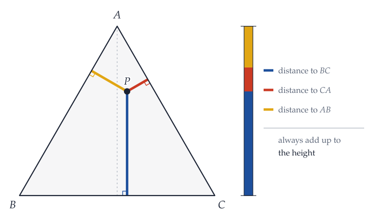
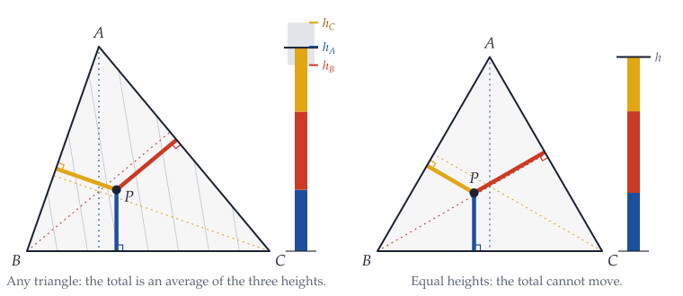
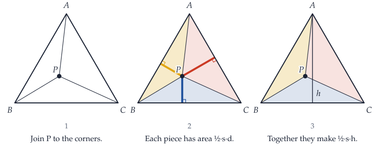
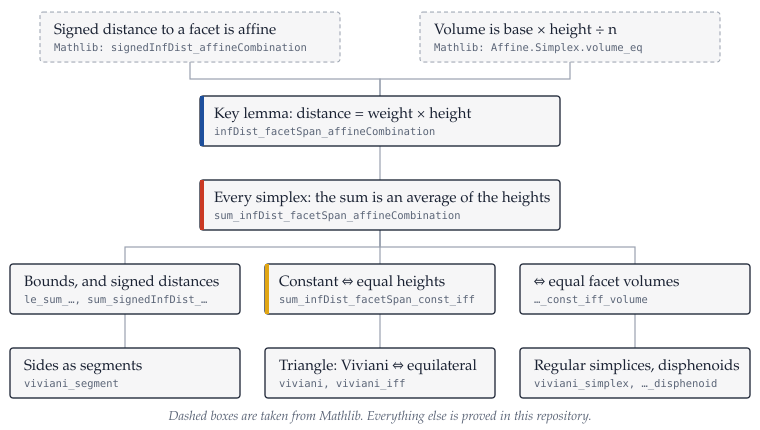

# Viviani’s theorem in Lean 4

[](https://github.com/redzwn/viviani-lean/actions/workflows/lean.yml)

From any point inside an equilateral triangle, the distances to the three sides add up to the triangle’s height. This repository proves that in [Lean 4](https://lean-lang.org) with [Mathlib](https://github.com/leanprover-community/mathlib4), and then follows the same idea as far as it goes: the converse, every triangle, the whole plane, and every dimension.

<p align="center">
  <picture>
    <source media="(prefers-color-scheme: dark)" srcset="assets/viviani-dark.svg">
    
  </picture>
</p>

## What is proved

Everything below is a theorem in this repository, with no `sorry` and no axioms beyond Lean’s standard three. Names link to the source.

| | Statement | Lean |
| --- | --- | --- |
| 1 | **Viviani’s theorem.** If the three sides of triangle $ABC$ are equal and $P$ lies in the closed triangle, the distances from $P$ to the three sides add up to $\tfrac{\sqrt3}{2}$ times the side. Stated for the sides as segments (the textbook wording) and for the lines through them. | [`viviani_segment`](Viviani/Classical.lean), [`viviani`](Viviani/Classical.lean) |
| 2 | **The converse.** In a genuine triangle, the distance sum is the same at every point *if and only if* the triangle is equilateral. | [`viviani_iff`](Viviani/Classical.lean) |
| 3 | **Every triangle.** At $P = aA + bB + cC$ the distance sum is $a\,h_A + b\,h_B + c\,h_C$, a weighted average of the three heights. So it lies between the shortest and the tallest height. | [`sum_infDist_eq_of_affineIndependent`](Viviani/Classical.lean), [`le_sum_infDist_facetSpan`](Viviani/Simplex.lean) |
| 4 | **The whole plane.** With signed distances the identity holds at every point, inside or outside. | [`sum_signedInfDist_eq_of_height_eq`](Viviani/Simplex.lean) |
| 5 | **Every dimension.** In a simplex of dimension $n$ with all edges $r$, the distances to the $n+1$ facets add up to $\sqrt{(n+1)/(2n)} r$. For a regular tetrahedron that is $\sqrt{2/3} r$. | [`viviani_simplex`](Viviani/Regular.lean), [`viviani_tetrahedron`](Viviani/Tetrahedron.lean) |
| 6 | **When is the sum constant?** In any simplex: exactly when all heights are equal, which is exactly when all facets have the same volume. In particular it is constant in every disphenoid (a tetrahedron with opposite edges equal), regular or not. | [`sum_infDist_facetSpan_const_iff_volume`](Viviani/Simplex.lean), [`viviani_disphenoid`](Viviani/Tetrahedron.lean) |
| 7 | **The area identity** behind the classical proof: $\sum_i d_i \cdot \mathrm{vol}(F_i) = n \cdot \mathrm{vol}(S)$. | [`sum_infDist_facetSpan_mul_volume`](Viviani/Simplex.lean) |

The headline statement, exactly as in [`Viviani/Classical.lean`](Viviani/Classical.lean):

```lean
theorem viviani_segment {V : Type*} [NormedAddCommGroup V] [InnerProductSpace ℝ V] {A B C P : V}
    (hAB : dist A B = dist B C) (hCA : dist C A = dist B C)
    (hP : P ∈ convexHull ℝ {A, B, C}) :
    infDist P (segment ℝ B C) + infDist P (segment ℝ C A) + infDist P (segment ℝ A B) =
      Real.sqrt 3 / 2 * dist B C
```

Read `convexHull ℝ {A, B, C}` as “the filled-in triangle”, `segment ℝ B C` as “the side $BC$”, and `infDist P s` as “the shortest distance from $P$ to the set $s$”. There is no non-degeneracy hypothesis: if the three points coincide, both sides are zero.

## The one idea

Write a point of the triangle as a weighted average of the corners, $P = aA + bB + cC$ with $a + b + c = 1$. Distance to the line $BC$, taken with a sign, is an affine function of the point, and it vanishes at $B$ and at $C$. So at $P$ it is $a$ times its value at $A$:

$$
d(P, BC) = a \cdot h_A .
$$

Distance to a side is the opposite corner’s weight times that corner’s height. Add the three sides and you get the weighted average $a h_A + b h_B + c h_C$. That is the whole theory; the rest is reading it.

<p align="center">
  <picture>
    <source media="(prefers-color-scheme: dark)" srcset="assets/every-triangle-dark.svg">
    
  </picture>
</p>

- If the three heights are equal, the average is that height wherever $P$ is. Equal sides give equal heights, because height times side is twice the area from every corner. That is Viviani’s theorem.
- If the sum is constant, evaluate it at the three corners, where it equals the three heights. So the heights are equal, and then so are the sides. That is the converse.
- Nothing used the plane. The same sentences, with “facet” for “side”, work in a tetrahedron and in every dimension.

The classical proof by areas is still here, as a consequence instead of a method: each distance times its side, summed, is twice the area.

<p align="center">
  <picture>
    <source media="(prefers-color-scheme: dark)" srcset="assets/proof-areas-dark.svg">
    
  </picture>
</p>

## How the development is organised

<p align="center">
  <picture>
    <source media="(prefers-color-scheme: dark)" srcset="assets/map-dark.svg">
    
  </picture>
</p>

| File | Contents |
| --- | --- |
| [`Viviani/Simplex.lean`](Viviani/Simplex.lean) | Any simplex, any dimension: the key lemma, the weighted-average formula, bounds, constant ⇔ equal heights ⇔ equal facet volumes, signed distances, the area identity. |
| [`Viviani/Triangle.lean`](Viviani/Triangle.lean) | Triangles: equilateral ⇔ equal heights; Viviani and its converse. |
| [`Viviani/Regular.lean`](Viviani/Regular.lean) | The height of a regular $n$-simplex, and Viviani in every dimension. |
| [`Viviani/Tetrahedron.lean`](Viviani/Tetrahedron.lean) | The regular tetrahedron and the disphenoid. |
| [`Viviani/Classical.lean`](Viviani/Classical.lean) | The textbook statements for three points $A$, $B$, $C$, including sides as segments. |
| [`Viviani/Examples.lean`](Viviani/Examples.lean) | The triangle $(0,0)$, $(2,0)$, $(1,\sqrt3)$: the hypotheses hold and the sum is $\sqrt3$. |

Two results are Mathlib’s and deserve credit by name: `Affine.Simplex.signedInfDist_affineCombination`, the signed form of the key lemma, and `Affine.Simplex.volume_eq`, base times height for simplices. This repository proves what follows from them. The general theorems live in a Euclidean affine space (`NormedAddTorsor V P`), as Mathlib’s geometry does; the textbook statements are given for points of an inner product space so that `convexHull` and `segment` can be used directly.

## What was checked

| Check | Result |
| --- | --- |
| Lean 4 compiler and kernel, warnings treated as failures | No errors, no warnings |
| Axiom audit of every declaration in the project (85, counting generated ones) | `propext`, `Classical.choice`, `Quot.sound` only |
| The 22 main statements compared with a recorded copy | Identical |
| `leanchecker` kernel replay of all six modules | Passed |
| [nanoda](https://github.com/ammkrn/nanoda_lib), an independent checker written in Rust, on the main theorems and everything they depend on | 48,926 declarations, no errors |
| Tamper tests: a `sorry`, an added axiom, `native_decide`, a swapped statement | All four rejected |
| [GitHub Actions](https://github.com/redzwn/viviani-lean/actions/workflows/lean.yml) on a fresh machine | Build, source scan, axiom audit, statement check |

“Independent” here means a separate implementation of the type checker, not review by other people. What remains on trust: the three axioms, the two checkers, and that the Lean statements mean what the English says. Versions, hashes and the full transcript are in [VERIFICATION.md](VERIFICATION.md); every public claim is tied to its evidence in [docs/CLAIMS.md](docs/CLAIMS.md).

## Check it yourself

You need [elan](https://lean-lang.org/install/). An ordinary laptop is enough; Mathlib’s prebuilt files take about 7 GB of disk.

```bash
git clone https://github.com/redzwn/viviani-lean
cd viviani-lean
lake exe cache get     # download prebuilt Mathlib
lake build             # check every proof
scripts/verify.sh      # all the checks above (the nanoda steps need leanexport and nanoda_bin)
```

Lean and Mathlib are pinned in [`lean-toolchain`](lean-toolchain), [`lakefile.toml`](lakefile.toml) and [`lake-manifest.json`](lake-manifest.json).

## Related work

**The mathematics is not new.** The converse for triangles is due to Chen and Liang (*College Math. J.* 37, 2006). The general triangle, with its parallel lines of equal sum, is in Abboud, “On Viviani’s theorem and its extensions” (*College Math. J.* 41, 2010; [arXiv:0903.0753](https://arxiv.org/abs/0903.0753)); the bounds by the shortest and tallest height are in Polster, “Viviani à la Kawasaki: take two” (*Math. Mag.* 87, 2014). The regular tetrahedron is treated by Kawasaki, Yagi and Yanagawa (*Math. Gaz.* 89, 2005). That the sum in a tetrahedron is constant exactly for equifacial tetrahedra is attributed to Katsuura in Wittenburg and Egle, [“Sums of distances from a point to the faces of polyhedra”](https://publikationen.bibliothek.kit.edu/1000186835). That equal face areas force congruent faces is Bang’s theorem (1897); it is not formalized here.

**Earlier Lean formalizations exist**, and priority is theirs:

- Robb Walters’ [lean-genius](https://github.com/rjwalters/lean-genius) collection proves a coordinate version for the unit equilateral triangle (June 2026), with a converse and a related identity for regular polygons and simplices.
- Joshua Bald’s [Viviani development](https://github.com/jpbald93/viviani) (September 2026, extended in October; [preprint](https://doi.org/10.5281/zenodo.23653348)) proves the signed-distance identity for simplices of every dimension, that equal heights are equivalent to a constant sum, and the classical statement for equilateral triangles in Euclidean affine spaces, including the value $\tfrac{\sqrt3}{2}$ times the side.

Our first version (a single file) was written without knowing of either; we found them afterwards. The present development was then written without consulting their code. We have not compared the projects line by line and make no claim to have done anything first.

## Background

Vincenzo Viviani (1622–1703) was a Florentine mathematician who, as a teenager, became Galileo’s assistant and was his last student. The theorem is the reason ternary plots work: in the triangular charts used for mixtures of three ingredients, each share is read as a distance to a side, and the three always total 100%.

## Author

redzwn. I chose the project and its scope, set the standards it had to meet (work independently of the earlier formalizations, make every claim checkable, credit everything), directed the work and reviewed the results.

The Lean code and figures were written with the help of Claude (Anthropic), an AI assistant: Claude Opus 5.5 for the first version and Claude Fable 5.2 for this one. Every proof is checked by the tools above, so the result does not rest on trusting either of us.

## Citing

Use the “Cite this repository” button on GitHub, or [`CITATION.cff`](CITATION.cff).

## License

[Apache 2.0](LICENSE), the same license as Mathlib.
